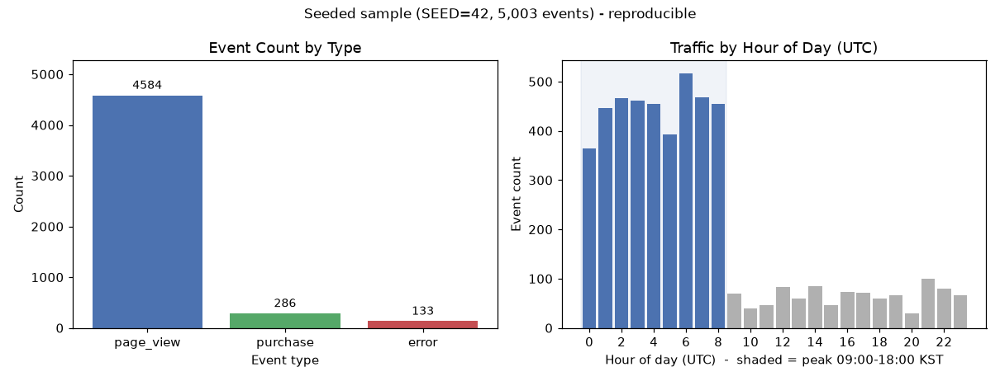

# Event Pipeline — seeded web-telemetry simulator with a PostgreSQL analytics pipeline

[](https://github.com/hurjun/futurescole/actions/workflows/ci.yml)

This project simulates web-service events (page views, purchases, errors), stores them in PostgreSQL, and draws analytics charts. Docker Compose runs the three steps as one batch job that exits on its own. With `SEED=42`, every run produces the same data, so each number below regenerates exactly. Kubernetes manifests and an AWS design sketch are included but not deployed.

Why it exists: a failure-prediction model needs telemetry with known ground truth. Here every session's error and purchase labels are known by construction, so detection queries can be checked against the truth instead of eyeballed. The repo itself does no fault diagnosis.



## Result

Measured from one deterministic run (`SEED=42`, `EVENT_COUNT=5000`). Data is synthetic.

- 5,003 events in 1,513 sessions from a fixed pool of 50 users; identical on every seeded run.
- Session conversion rate 18.9% (target ~20%); session error rate 8.8% (target ~10%).
- Peak-hour share (00–09 UTC = 09–18 KST) 80.5% (theoretical ~81%).
- 22 hermetic pytest tests (no live PostgreSQL); CI runs `ruff` and `pytest` on Python 3.12 and 3.13.

| Event type | Count (share) |
|------------|---------------|
| `page_view` | 4,584 (91.6%) |
| `purchase` | 286 (5.7%) |
| `error` | 133 (2.7%) |

Per-event purchase/error shares (~6% / ~3%) are lower than the per-session rates (~19% / ~9%) because every session has several page views.

## How it works

- `db` starts PostgreSQL 16 and must pass a healthcheck before anything else runs.
- `generator` (Python + Faker, a fake-data library) builds `EVENT_COUNT` events session by session, bulk-inserts them, and exits 0.
- Each session has 1–5 page views, a purchase with 20% chance, and an error with 10% chance.
- 70% of sessions land in 09:00–18:00 KST; the rest spread evenly over the day.
- `visualizer` (Python + matplotlib) waits for the generator, runs the SQL aggregations, and writes two PNG charts to `./output/`.

Common fields (`event_type`, `user_id`, `session_id`, `timestamp`) are plain columns; three of them (`event_type`, `user_id`, `timestamp`) are indexed. Per-type metadata lives in one `JSONB` column (binary JSON, indexable).

## Run it

Prerequisites: Docker Desktop (or any Docker Engine with Compose v2) running.

```bash
git clone https://github.com/hurjun/futurescole.git
cd futurescole
docker compose up --build                            # charts appear in ./output/
SEED=42 EVENT_COUNT=5000 docker compose up --build   # the deterministic run behind the Result table
pip install -r requirements-dev.txt                  # dev deps for lint + tests
pytest                                               # 22 tests, no Postgres needed
```

## Limitations

- All data is synthetic. The generator defines the distributions, so the results confirm the design targets, not a real service.
- Kubernetes manifests (`k8s/`) and the AWS design (`aws/`) were never deployed or tested on a live cluster or account.
- Only counts and rates are reproducible; absolute timestamps shift with the wall clock.
- The default credentials (`eventuser`/`eventpass`) are demo values for local runs only.
- DB connection retry is 5 attempts with an increasing wait (2 s, 4 s, 6 s, 8 s), linear not exponential.

## More

- [Details](docs/DETAILS.md): architecture diagram, full results table, event model, schema rationale, reproducibility, test coverage, engineering decisions, and the Kubernetes/AWS sketches.
- [`analysis/queries.sql`](analysis/queries.sql): the four analytics queries (count by type, Top-10 users, hourly distribution, error ratio).
- [`analysis/make_figures.py`](analysis/make_figures.py): regenerates the figure above offline with SQLite.
- [CI workflow](.github/workflows/ci.yml): lint and tests on every push and pull request.

## License

MIT — see [LICENSE](LICENSE).

— Jun Hur · [portfolio](https://hurjun.github.io) · [KCC 2024 paper](https://hurjun.github.io/asset/kcc2024-kiise-nursing-record-paper.pdf) · hurjun96@gmail.com
